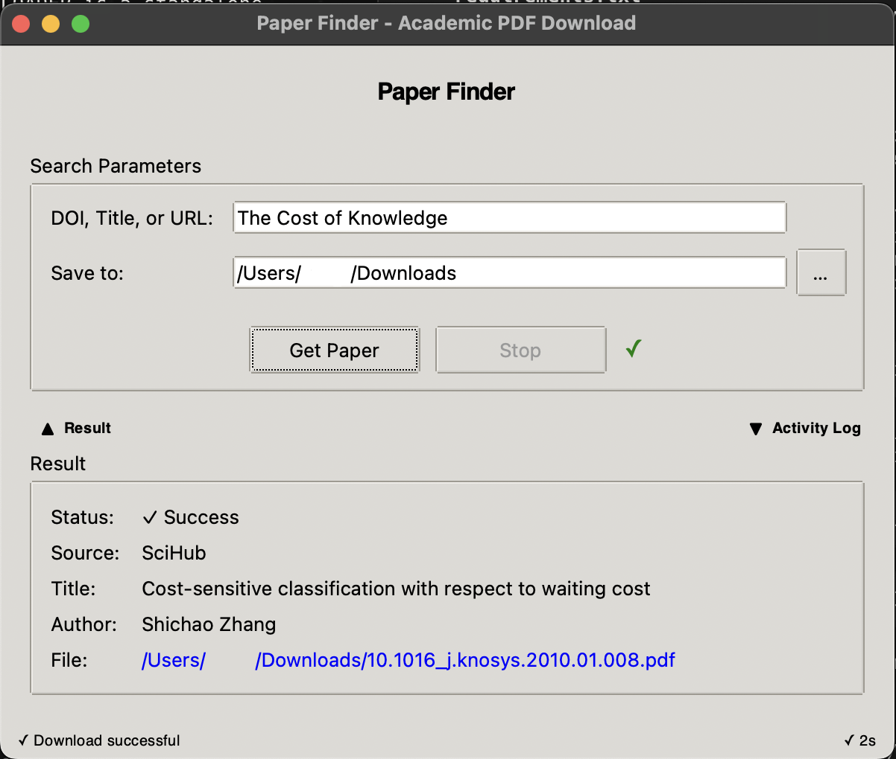
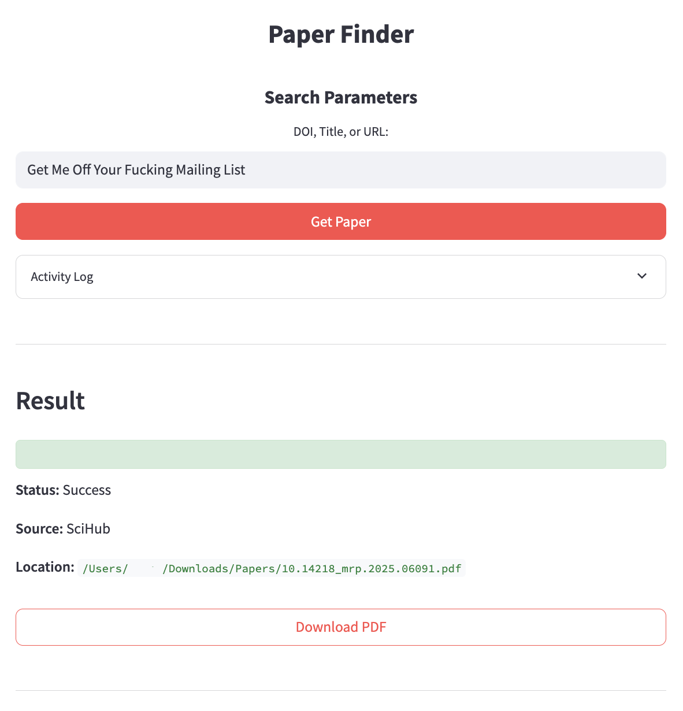

# Paper Finder – Identify First, Then Acquire

Paper Finder is a **maximum‑access retrieval engine** for academic literature.

### Desktop GUI


### Streamlit Web Interface


Input can be **anything that points to a specific work**:

- DOI
- ISBN
- URL (publisher, arXiv, bioRxiv, repository, etc.)
- Title (with or without authors / year)

The system does two separate jobs:

1. **Identity resolution** – figure out *exactly which paper/book* you mean.
2. **Content acquisition** – use all known metadata to get the **full text** (PDF or genuine full‑text HTML).

This README documents that philosophy and the source‑priority strategy, so behavior is clear and testable.


## 1. Identity Resolution – “Know the Paper First”

Whenever you query Paper Finder (GUI, CLI, Telegram, tests), the first stage is to **normalize and identify the target work**.

### 1.1 Accepted inputs

- **DOI** – e.g. `10.1126/science.adk3222`, `10.1038/171737a0`
- **ISBN** – e.g. `978-0226458083`, `9780815344322`
- **URLs** – `https://doi.org/...`, publisher pages, arxiv/biorxiv links, repository links
- **Titles** – optionally with authors and/or year

### 1.2 What identity resolution does

From any input, the resolver tries to build a **canonical metadata record**:

- **ID**: DOI, ISBN, arXiv ID, bioRxiv/medRxiv DOI, etc.
- **Title**: normalized full title.
- **Authors**: list of authors (last names at minimum).
- **Year**.
- **Journal / book title / publisher**.
- **Extra**: volume, issue, pages, subject hints.

It uses:

- Crossref (for DOIs / titles).
- arXiv / bioRxiv / medRxiv APIs or patterns.
- ISBN / book metadata APIs (for books).
- Heuristics over URLs to classify the host (publisher, OA repo, preprint, etc.).

This **identity step is separate from downloading**. Its job is only to answer:

> “Which exact work are we talking about?”

The resolved metadata is shown in the UI / logs (`Found paper: …`, `Year: …`, `Journal: …`) before acquisition starts.


## 2. Content Acquisition – “Now Get the Full Text”

Once the system “knows the paper”, it runs an **Acquisition Pipeline** that tries many sources in a **strictly ordered tiered strategy**.

Key rule: **success = full text**

- A **PDF** that passes basic and content validation, or
- A **trusted full‑text HTML article** (e.g. arXiv, PLOS, SciELO, some publisher OA pages).

An abstract‑only page (like many ACS or PubMed abstracts) **never counts as success**, even if the DOI and title match.


## 3. Source Priority Strategy

The pipeline uses tiers. **Earlier tiers are more decisive**; if any tier succeeds, later ones are cancelled.

### 3.1 Tier 1 – Direct “whole‑thing‑or‑nothing” sources

These sources are used **first**, because when they succeed they return the **entire** article or book, not a preview.

- **Sci‑Hub** (papers)
  - Queried by DOI (and sometimes title).
  - If Sci‑Hub returns a valid PDF and it passes relaxed but sane validation, we accept.
  - Validation is tuned for Sci‑Hub (see §4).

- **Anna’s Archive** (books and some articles)
  - For ISBNs and book‑like metadata, queried by ISBN + title + authors.
  - For some articles, queried by DOI and/or title.
  - When it returns a full book/article file and validation passes, we accept.

If any Tier‑1 source yields a valid full text → **pipeline stops with success**.

### 3.2 Tier 2 – Underground mirrors (Telegram)

These are **parallel mirrors** of Tier‑1 sources with different coverage and reliability.

- Telegram bots (e.g. `@scihubot`, LibGen bots, Z‑Library bots, etc.).
- Input: same canonical metadata (DOI, title, ISBN).
- Often wrap Sci‑Hub / LibGen / Z‑Library but sometimes find extras.

Tier 1 and Tier 2 generally run **in parallel**; the **first valid full text wins**, and the rest are cancelled.

### 3.3 Tier 3 – Open Access & repositories

If underground sources fail, the pipeline focuses on **legit OA paths**:

- **Unpaywall**
  - Ask for `is_oa` and `oa_locations` for the DOI.
  - Prefer repository locations (`host_type=repository`):
    - `arxiv.org`, `biorxiv.org`, `medrxiv.org`
    - `zenodo.org`, `figshare.com`, `osf.io`
    - `scielo.org`, `europepmc.org`, institutional repositories.
  - For each location:
    - If `url_for_pdf` is present → download & validate PDF.
    - If only an HTML URL is present but clearly full text (e.g. PLOS, arXiv abs page with “View PDF”) → open in browser and count as **Open Access (Browser)** success.

- **Direct OA hosts by pattern**
  - arXiv: direct `https://arxiv.org/pdf/{id}.pdf` where possible.
  - bioRxiv / medRxiv: canonical PDF/HTML URLs when the DOI is `10.1101/...`.
  - SciELO and other OA repositories with stable URL patterns.

These paths are also what the GUI uses for its “Paper is Open Access (fast check)” messages.

### 3.4 Tier 4 – Publisher landing pages

If OA fails, Paper Finder tries the **publisher landing page** for the DOI:

- Follow `https://doi.org/...` to the publisher (ACS, Wiley, Springer, Elsevier, Cell, etc.).
- Attempt to locate a real **PDF** (download button, `application/pdf` link, etc.).
  - If found and validated → success.

If the page is clearly **full‑text HTML** (long article, sections, references) and you accept HTML as success, the system can:

- Open the article page in the browser via the same callback used in the GUI.
- Mark this as **Open Access (Browser)** success.

However, if the page is **abstract‑only** (like many ACS articles without access):

- Identity is confirmed, but **no full text is available**.
- This **does not count as success**.
- The pipeline keeps searching other sources.

### 3.5 Tier 5 – Deep/exotic search

Only after all above fail, the system uses heavy, slower methods:

- Enhanced Google Scholar / Baidu / multi‑language search.
- National / institutional repositories.
- International OA portals (SciELO, Dialnet, HAL, etc.).
- Title‑ and author‑based heuristics with looser matching.

These can take longer and may find rare copies when everything else fails.


## 4. Validation Philosophy

The validation code in `src/core/validation.py` enforces that **“success” really means “this is the right work”**, but treats sources differently depending on how risky they are.

### 4.1 Common checks

For any PDF candidate:

- Basic PDF sanity (magic bytes `%PDF-`, size, no obvious HTML error).
- Extract text from the first N pages.
- Compute:
  - **`title_sim`**: similarity between requested title and extracted text.
  - **`doi_ok`**: whether the DOI (or equivalent ID) appears in the text.

### 4.2 Sci‑Hub vs other shadow libraries

Sci‑Hub is not treated the same as generic “shadow libraries”:

- **Sci‑Hub** (queried by DOI) is allowed a **more relaxed rule**:
  - If the DOI appears in the text → accept.
  - For **classic papers** (e.g. pre‑1970) where OCR is messy:
    - Accept at **moderate** title similarity.
  - For more recent papers:
    - Accept at a **reasonably high** title similarity, lower than for Anna’s/LibGen.

- **Other shadow libraries** (Anna’s Archive for articles, LibGen, Telegram channels) remain **stricter**:
  - Prefer DOI in text.
  - Require higher title similarity thresholds to avoid mismatches.

This matches the “if I paste a DOI into Sci‑Hub, it’s almost always the right paper” heuristic, while keeping stricter rules for noisier sources.

### 4.3 OA, publishers, repositories

- **OA/preprint hosts** (arXiv, bioRxiv, medRxiv, PMC, etc.):
  - Trusted for content; moderate title similarity is enough.

- **Repositories** (Zenodo, Dataverse, SciELO, etc.):
  - Allow a bit lower title similarity, or a DOI match.

- **Publishers**:
  - Treated as high‑quality metadata sources.
  - Accept with moderate title match or DOI match.

And crucially:

- **Abstract‑only pages never count as success** (regardless of DOI/title match).


## 5. No Sources Lost – Restructuring Rules

Over time, the code has accumulated many sources:

- Sci‑Hub (with multiple domains and updaters).
- Anna’s Archive, LibGen, Z‑Library, PDFDrive, BookFi, and other book/article archives.
- Telegram bots wrapping various underground and public sources.
- Standard OA sources: arXiv, bioRxiv, medRxiv, PMC, HAL, SciELO, Zenodo, Dataverse, OSF, CORE, etc.
- Publisher‑specific strategies and landing‑page scrapers.
- Deep search strategies (Google Scholar, Baidu, institutional repositories, multi‑language search).

**Restructuring rule:**

- **No existing source should be removed.**
- You may:
  - Re‑order sources across tiers.
  - Tighten or relax validation rules per source type.
  - Add new domains, bots, or repositories.
- But you should **not drop a working source** just to simplify code. If you find a hard‑coded domain or a niche scraper, either keep it or expand it – don’t delete it.

The goal of refactors is to **improve ordering, performance, and clarity**, not to shrink the set of places we can search.


## 6. Usage

### 6.1 Install

```bash
pip install -r requirements.txt
```

### 6.2 Optional: enable Telegram underground

```bash
# Get Telegram API credentials from https://my.telegram.org
export TELEGRAM_API_ID='your_id_here'
export TELEGRAM_API_HASH='your_hash_here'

python auto_enable_underground.py

# or interactive setup
python setup_telegram_underground.py
```

### 6.3 Run GUI / CLI

```bash
python main.py
```

Paste a DOI / ISBN / URL / title and follow the prompts.

### 6.4 Command line examples

```bash
# Direct acquisition (CLI mode)
python main.py acquire "10.1038/171737a0" --output ~/papers

# Run Telegram bot server
python main.py bot
```

### 6.5 Python API (simplified)

```python
from paper_finder import PaperFinder

finder = PaperFinder()
result = finder.find("10.1038/171737a0", output_dir="./downloads")

if result.success:
    print("Source:", result.source)
    print("File:", result.filepath)
else:
    print("Failed:", result.error)
```


## 7. Configuration

Basic configuration lives in `config.yaml` (see also `config.yaml.example`). For example:

```yaml
telegram:
  underground_enabled: true
  api_id: YOUR_ID
  api_hash: YOUR_HASH
  rate_limit_per_hour: 20

network:
  max_workers: 8
  timeout_short: 10

pipeline:
  parallel_execution: true
```

The details of per‑source behavior (e.g. Sci‑Hub domains, Anna’s Archive, international repositories) live in `src/core/config.py` and the various `src/acquisition/*` modules.


## 8. Testing & Benchmarks

### 8.1 Unit / integration tests

```bash
pytest tests/
```

### 8.2 Real‑world benchmark

`tests/test_benchmark_real.py` contains a set of **real DOIs/ISBNs** across:

- Open Access (Nature, PLOS, SciELO).
- Preprints (arXiv, bioRxiv).
- Classics (Watson–Crick, Shannon, Woodward–Hoffmann).
- Books (biology, chemistry, philosophy).
- Paywalled recent papers.
- History and philosophy of science.
- Invalid/edge cases.

The benchmark uses the **same `PaperFinder.find` path as the GUI**, including OA/browser callbacks, so behavior should match what you see interactively.


## 9. Legal Notice

This tool is for **research purposes only**. It may access:

- Public and semi‑public repositories.
- Unofficial mirrors and caches.
- Community‑shared content.

You are responsible for complying with:

- Your institution’s policies.
- Copyright law in your jurisdiction.
- Terms of service of accessed platforms.

Use responsibly and always **cite the original works properly**.
