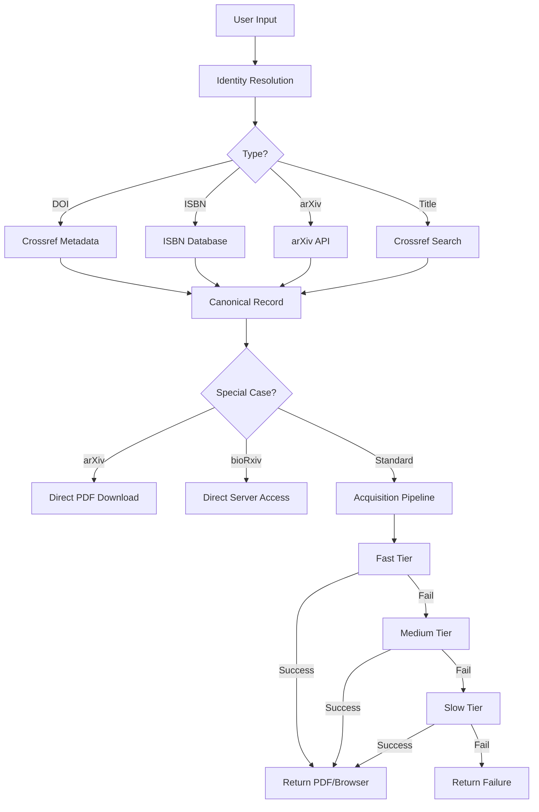

# Paper Finder Architecture

## Overview

The Paper Finder system follows a strict **"identify first, then acquire"** philosophy. This architecture separates the concern of figuring out WHAT we're looking for (identity resolution) from HOW to get it (acquisition).

## Core Components

### 1. Identity Resolution (`src/core/identity.py`)

**Purpose:** Convert any reference into a canonical metadata record.

**Input Types:**
- DOI (e.g., `10.1038/nature12373`)
- ISBN (e.g., `978-0-226-458083`)
- arXiv ID (e.g., `arXiv:2311.12345`)
- bioRxiv/medRxiv DOI (e.g., `10.1101/2023.07.04.547696`)
- URLs (automatic type detection)
- Title/citation text (resolved via Crossref)

**Output:** Canonical metadata record with:
```python
{
    "identifier": {
        "type": "doi" | "isbn" | "arxiv" | "biorxiv" | "title",
        "value": "10.1038/171737a0"
    },
    "title": "Molecular structure of nucleic acids",
    "authors": ["J. D. Watson", "F. H. C. Crick"],
    "year": 1953,
    "journal": "Nature",
    "publisher": "Nature Publishing Group",
    "metadata_source": "crossref" | "arxiv" | "manual"
}
```

### 2. Acquisition Pipeline (`src/core/pipeline.py`)

**Purpose:** Execute tiered source acquisition with early stopping.

**Tiers:**
1. **FAST** (<20s typical): Shadow libraries, direct URLs
2. **MEDIUM** (<60s typical): OA repositories, APIs
3. **SLOW** (<120s max): Web discovery, deep search

**Features:**
- Parallel execution within tiers
- Short-circuit on success or browser open
- Cancellation support
- Caching integration

### 3. Paper Finder (`paper_finder.py`)

**Purpose:** Main orchestrator that ties everything together.

**Workflow:**
1. Receive reference string from user
2. Pass to IdentityResolver for canonical metadata
3. Handle special cases (arXiv, bioRxiv) with fast-paths
4. Execute AcquisitionPipeline with tiered sources
5. Return result (PDF file, browser open, or failure)

## Source Organization

### Fast Tier (Highest Priority)

```python
# Shadow Libraries
"SciHub"            # Updated domains daily
"Anna's Archive"    # 100M+ papers/books
"LibGen"           # Legacy but reliable

# Parallel Sources
"Telegram Bots"     # If configured
"Open Access (Browser)"  # Immediate OA detection
```

### Medium Tier (APIs & Repositories)

```python
# Open Access APIs
"Unpaywall"         # Official OA index
"PubMed Central"    # Biomedical papers
"Europe PMC"        # 3M+ OA papers
"Semantic Scholar"  # CS/AI focus
"CORE.ac.uk"        # 200M+ aggregated

# Direct Access
"Crossref Direct"   # Publisher links
"Landing Page"      # HTML extraction
"Publisher Patterns"  # Known URL patterns
"Preprints Enhanced"  # arXiv, bioRxiv, etc.
```

### Slow Tier (Web Discovery)

```python
"Google Scholar"    # General search
"International"     # SciELO, etc.
"Multi-language"    # Translated searches
"Chinese Sources"   # CNKI, Wanfang, VIP
"Deep Crawl"        # Author homepages
```

## Key Design Decisions

### 1. Explicit Identity Resolution

**Why:** Separates concerns, enables better caching, and allows for multiple resolution strategies.

**Benefits:**
- ISBN books don't go through DOI resolution
- arXiv papers get direct fast-path
- Title searches can be enhanced independently

### 2. Tiered Acquisition

**Why:** Optimize for speed while maintaining high success rate.

**Benefits:**
- Fast sources run first (most likely to succeed)
- Parallel execution within tiers
- Early stopping saves time
- Hard timeout prevents hanging

### 3. Strict Success Semantics

**Success means:**
- Validated PDF downloaded, OR
- Full-text HTML opened in browser

**NOT success:**
- Abstract-only pages
- Invalid PDFs
- Metadata-only records

### 4. Source Classification for Validation

Different sources have different trust levels:

```python
# Sci-Hub: More lenient validation
- Trust DOI presence in PDF
- Accept moderate title similarity
- Relax year matching for older papers

# Other Shadow Libraries: Stricter
- Require high title similarity
- Check year matches
- Validate authors if available

# Publishers: Very strict
- Full metadata validation
- Content verification
```

## Data Flow



## Error Handling

### Identity Resolution Failures
- Falls back to manual metadata
- Attempts title-based search
- Returns error if completely unresolvable

### Acquisition Failures
- Each source failure is logged
- Pipeline continues to next tier
- Comprehensive attempt tracking for debugging

### Network Issues
- Automatic retry with backoff
- Timeout protection
- Graceful degradation

## Performance Optimizations

### 1. Fast-Paths
- arXiv: Direct PDF construction
- bioRxiv/medRxiv: Direct server access
- ISBN: Skip DOI resolution entirely

### 2. Parallel Execution
- Within-tier parallelism (3 workers)
- Independent source execution
- Early termination on success

### 3. Caching
- Sci-Hub domain caching (daily update)
- Successful source tracking
- Metadata caching

### 4. Timeout Management
```python
TIMEOUTS = {
    'fast': 20,     # Per-source timeout
    'medium': 30,   # Per-source timeout
    'slow': 60,     # Per-source timeout
    'total': 120    # Hard limit for entire search
}
```

## Extension Points

### Adding New Sources

1. Create source module in `src/acquisition/`
2. Implement acquisition method
3. Register in appropriate tier:

```python
# In _register_sources()
self.pipeline.register_source(
    name="New Source",
    function=self._try_new_source,
    tier='medium'  # fast/medium/slow
)
```

### Adding New Identifier Types

1. Update `IdentityResolver.resolve()`
2. Add extraction method (e.g., `_extract_pmid()`)
3. Add resolution method (e.g., `_resolve_pmid()`)
4. Update fast-path handling if needed

## Testing Strategy

### Unit Tests
- Identity resolution for each type
- Validation rules per source
- Individual source methods

### Integration Tests
- Full pipeline execution
- Cancellation handling
- Timeout behavior

### Benchmark Tests
- Real-world DOIs across disciplines
- Performance metrics
- Success rate tracking

## Security Considerations

### API Keys
- Environment variables for sensitive data
- Never hardcoded in source
- Graceful fallback if missing

### Web Scraping
- Respect robots.txt
- Rate limiting
- User-Agent rotation

### PDF Validation
- Content verification
- Metadata matching
- Size limits

## Future Enhancements

### Planned
- [ ] Enhanced title-based search
- [ ] PMID/PMCID support
- [ ] Batch processing optimization
- [ ] ML-based source selection

### Under Consideration
- Distributed acquisition
- Browser extension integration
- Local paper database
- Citation network traversal

## Maintenance

### Daily Tasks
- Sci-Hub domain updates (automated)
- Cache cleanup

### Weekly Tasks
- Source availability monitoring
- Performance metrics review

### Monthly Tasks
- Dependency updates
- New source evaluation
- Success rate analysis

---

*Last Updated: December 2024*
*Architecture Version: 2.0*
